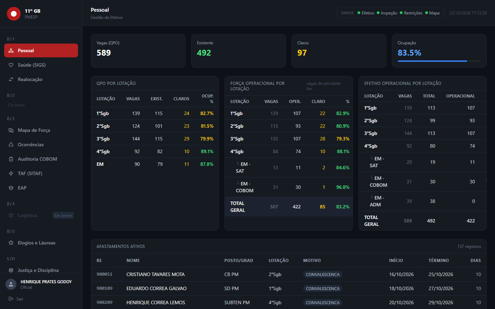
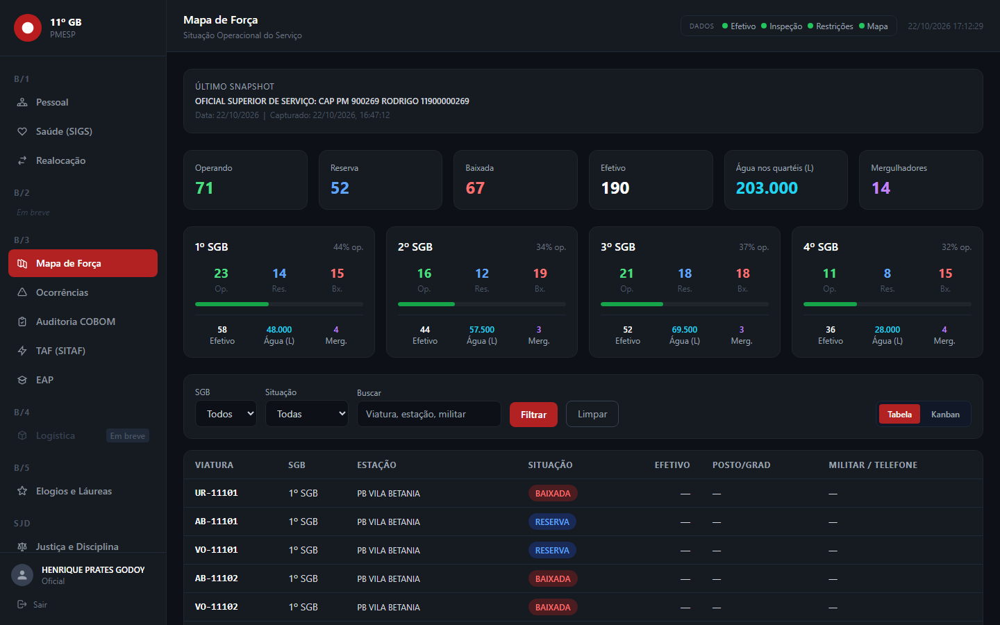
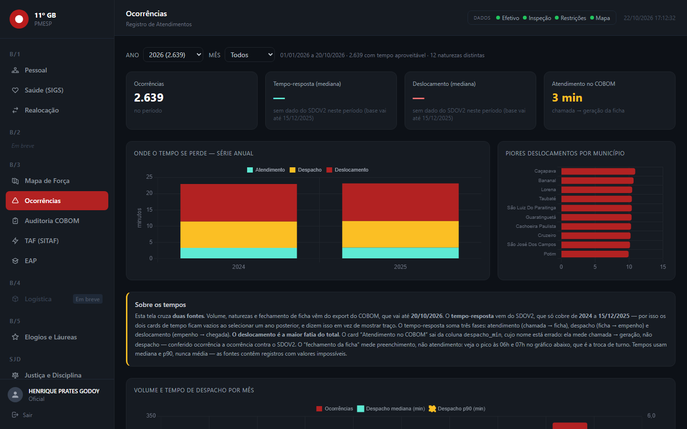
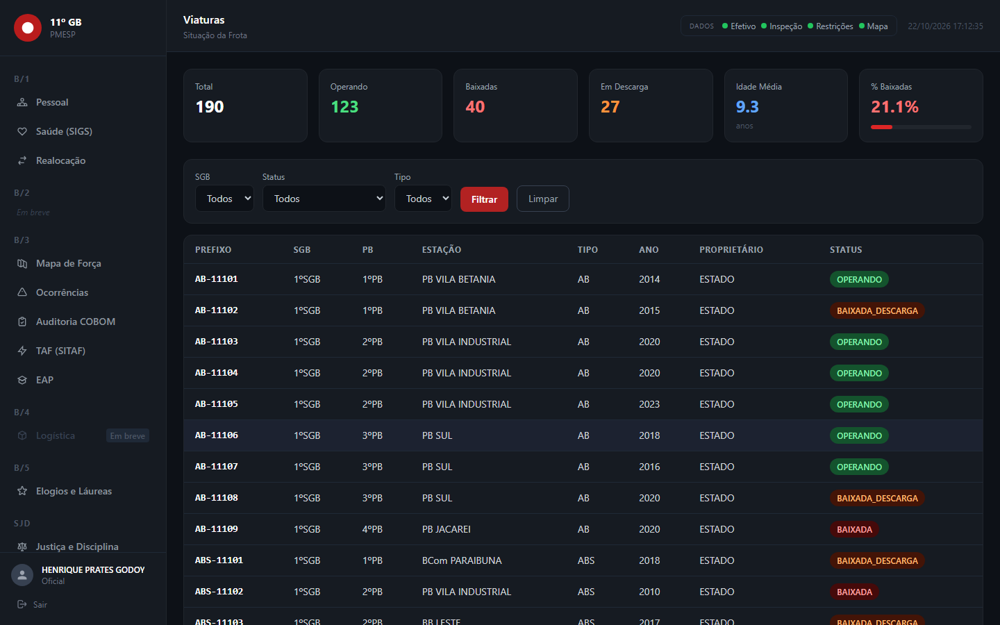
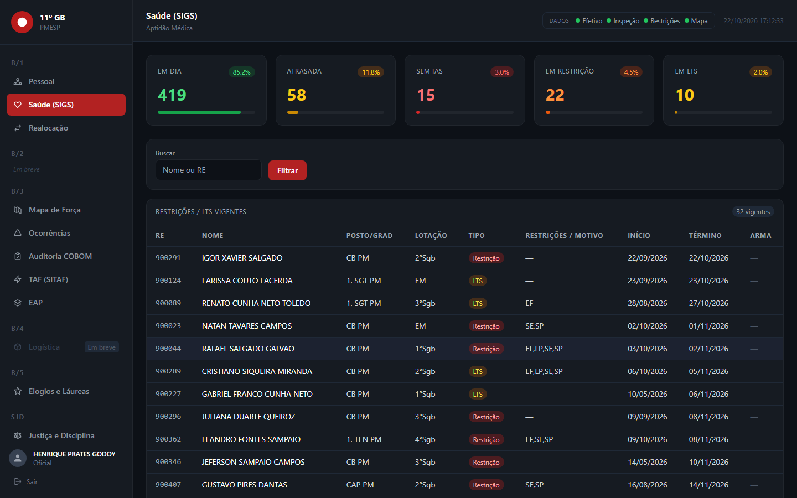
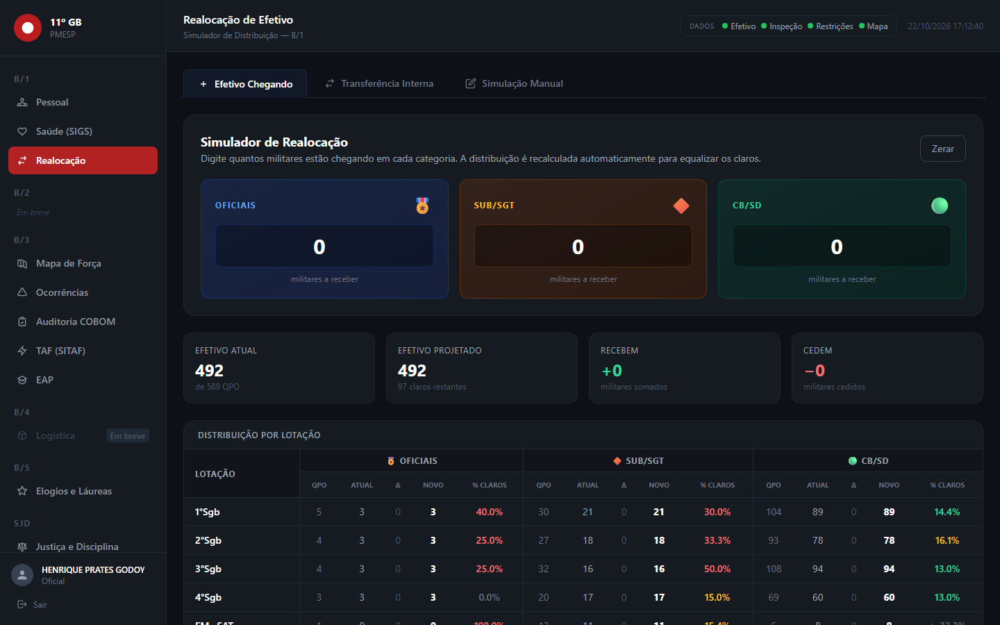
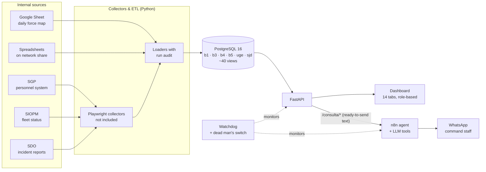

# 11º GB — Fire Department Operations Platform

[](https://github.com/Renan-Maciel-Santos/firefighter-ops-platform/actions/workflows/ci.yml)


Data platform, management dashboard and WhatsApp assistant built for a
firefighter battalion of ~500 personnel, 25 fire stations and ~190 vehicles in
São Paulo state, Brazil.

> **This is the public, sanitized copy of a system that runs in production.**
> The code is the production code. **All data is synthetic**: people, service
> numbers, phones, vehicles, incidents and procurement records are generated by
> [`seed/gerar_dados_ficticios.py`](seed/gerar_dados_ficticios.py), and the
> addresses of internal government systems were replaced with placeholders.

Unlike my other portfolio projects, this one was not designed from a blank
page. It grew inside a real organization: data scattered across three
corporate systems, spreadsheets on a network share and a Google Sheet,
answered by hand every morning. The interesting engineering is in making that
reliable: one source of truth, one place for each business rule, and an LLM
that is never allowed to produce a number.

## Demo

| Personnel vs. staffing table | Daily force map |
|---|---|
|  |  |
| **Incidents and response time** | **Fleet** |
|  |  |
| **Health inspections and restrictions** | **Staff reallocation simulator** |
|  |  |

*Screenshots regenerate with `python scripts/capturar_telas.py` against the running demo.*

The WhatsApp assistant (B.I.A.) answers the command staff. The script below makes
the same tool calls the agent makes and prints exactly what would be sent to
WhatsApp. Every number comes from the database; the model only relays the text:

```text
$ python scripts/demo_bia.py

Comandante: bom dia
   tool  → GET /consulta/identificar {'telefone': '5511900000010'}  (7 ms)
B.I.A.:     Às ordens, Cmt Bragança.

Comandante: como está o efetivo hoje?
   tool  → GET /consulta/efetivo   (12 ms)
B.I.A.:     *11º GB* — 492 militares
            • 462 aptos ao serviço · 30 com restrição ou LTS
            • 422 na atividade-fim · 70 em função administrativa
            ...

Comandante: quem está de serviço no PB Sul?
   tool  → GET /consulta/guarnicao {'estacao': 'PB SUL'}  (7 ms)
B.I.A.:     🚒 *AB-11106* — PB SUL (São José dos Campos)
            👮 1° TENENTE PM FARIAS
            📞 11900000274
            ...
```

## How it works



## Engineering highlights

- **The LLM never produces a number.** Every `/consulta/*` tool returns a
  `mensagem` field already rendered in WhatsApp format, and the agent is
  instructed to relay it verbatim. This was a measured decision: when the model
  formatted raw rows itself, it invented figures in roughly 12% of answers
  (including plausible ones like "0 divers"). See
  [`webapp/routers/consulta.py`](webapp/routers/consulta.py).
- **An evaluation harness for the agent, not vibes.** [`avaliacao_llm/`](avaliacao_llm/)
  replays question sets against candidate models and prompts, with dedicated
  tests for hallucinated names, tool failures, context overflow, memory-window
  limits and multi-turn follow-ups ("and his inspection?" after a lookup).
- **One place per rule.** Access control lives only in
  [`webapp/acesso.py`](webapp/acesso.py): the backend enforces it and the
  frontend *receives* it from `/auth/me`, so hiding a menu item is a consequence,
  not the protection. Unknown roles are denied by default. Staff classification
  (which unit, front-line or administrative) lives only in
  [`webapp/efetivo_regras.py`](webapp/efetivo_regras.py), shared by the dashboard
  and the assistant, so they can never disagree.
- **The database protects the freshest source.** A trigger
  (`b4.fn_viaturas_trava_siopm` in [`db/demo/schema.sql`](db/demo/schema.sql))
  keeps vehicle status coming from the live fleet system from being overwritten
  by the slower spreadsheet load for 3 days.
- **Idempotent, audited loads.** Every ETL run is recorded in `b1.etl_status`
  (rows read, inserted, updated, error); snapshot loads are deduplicated by
  SHA-256 of their content with `ON CONFLICT DO NOTHING`
  ([`B3/mapa_operacional.py`](B3/mapa_operacional.py)).
- **Operations, not just code.** [`bia_watchdog.py`](bia_watchdog.py) checks
  every link of the assistant chain (WhatsApp gateway, n8n, webapp, Postgres)
  *and* the freshness of each data load, restarts stopped containers and the
  webapp on its own, emails once per incident and pings an external dead man's
  switch so a powered-off host is also detected.
  [`backup_11gb.py`](backup_11gb.py) produces daily dumps encrypted with
  AES-256-GCM (scrypt-derived key) and copies them off-host.
- **Secrets fail fast.** [`_env.py`](_env.py) refuses to start when a required
  secret is missing and explains which one, instead of failing later as a
  misleading "wrong password".
- **The demo cannot hurt a real database.** The seed starts with
  `DROP SCHEMA ... CASCADE`, so it refuses any database that already has the
  dashboard schema without its own `demo.instancia` marker (covered by
  [`tests/integration/test_seed_guard.py`](tests/integration/test_seed_guard.py)),
  and the demo Postgres listens on `55432`, away from the default port.

## Quick start

Requirements: Docker with Compose.

```bash
cp .env.example .env
```

Fill in `PG_PASS`, `JWT_SECRET_KEY` and `N8N_TOKEN`
(`python -c "import secrets; print(secrets.token_urlsafe(48))"`), then:

```bash
docker compose up -d --build
docker compose exec webapp python ../seed/gerar_dados_ficticios.py --recriar
```

Open <http://127.0.0.1:8800> and sign in (password `demo1234`, or `DEMO_SENHA`):

| Login | Role | Sees |
|---|---|---|
| `900003` | admin | every tab plus user management |
| `900002` | officer | every tab |
| `demo.b1` | staff, personnel section | personnel, health, fitness test, commendations |
| `demo.b4` | staff, logistics section | fleet |

The seed is relative to today's date (the force map and fleet status show
"today's" capture), so re-run it with `--recriar` to refresh the demo on
another day. Interactive API docs: <http://127.0.0.1:8800/api/docs>.

## Tests and quality checks

```bash
pip install -r requirements.txt pytest ruff
ruff check .                 # real errors only (syntax, undefined names)
pytest -m unit               # pure rules: access control, document generation, parsers
pytest -m integration        # against the running stack: every tab, roles, assistant tools, seed guard
```

Integration tests **fail** instead of skipping when the stack is down, so a CI
run without it cannot pass by accident. GitHub Actions runs both jobs, the
second one on a fresh `docker compose` stack.

## Tech stack

| Technology | Role |
|---|---|
| **Python 3.12** | ETL, collectors, API, tooling |
| **FastAPI + SQLAlchemy** | API, JWT auth, role-based access |
| **PostgreSQL 16** | Single source of truth; business logic in ~40 views and a trigger |
| **Playwright** | Collectors for internal web systems without APIs (not included in this copy) |
| **pandas / openpyxl / gspread** | Spreadsheet and Google Sheets loaders |
| **python-docx / python-pptx** | Generated service orders and management reports |
| **n8n + Evolution API** | WhatsApp channel and agent orchestration |
| **LLM via OpenAI-compatible API (Ollama locally)** | Tool-calling agent, evaluated in `avaliacao_llm/` |
| **Tailwind + Chart.js** | Dashboard frontend (static, no build step) |
| **Docker Compose** | Demo stack and production infrastructure |
| **pytest + ruff + GitHub Actions** | Tests and CI |

## What runs in the demo, and what is reference only

The demo runs the **database, API, dashboard and the assistant's tool layer**.

The collectors that sign in to the organization's internal systems (personnel,
fleet status, incident reports) are **not included** in this public copy. The
ETLs that load their exports are, along with these modules, which depend on the
organization's network and accounts and are here to show how data reaches the
database, not to be executed:

- **Spreadsheet ETLs** in `B1/`, `B3/`, `B4/`, `B5/`, `UGE/`, `SJD/`, orchestrated
  by `rodar_etl_arquivos.py`.
- **The agent itself**: `n8n/` composes, `bia_watchdog.py` and the evaluation
  harness. The n8n workflow export is not included (it embedded
  a channel API key).
- **Report generators** in `relatorios/` and one-off geocoding scripts in
  `B3/*coordenadas*.py`.

Extra dependencies for those: `requirements-etl.txt`.

## Known limitations

- **Legacy-first structure.** Folders follow the organization's staff sections
  (B/1 personnel, B/3 operations, B/4 logistics, B/5 public relations) rather
  than technical layers, and comments are in Portuguese, the domain language
  of everyone who maintains it.
- **Schema as a snapshot.** `db/demo/schema.sql` is a `pg_dump --schema-only`
  of production; the `migra_*.sql` files are the history that produced it, not
  a migration tool such as Alembic.
- **Test coverage is targeted, not exhaustive.** Tests cover the rules that
  would hurt if they broke (access, staff classification by unit, assistant
  output, the seed guard) and smoke-test every dashboard route. Collectors are
  not tested here because their targets are not reachable outside the intranet.
- **Synthetic data has limits.** The "Weapon" column in Health is empty by
  design (the source does not provide it), and response-time data ends in the
  previous December, as in production.

## Project structure

```
webapp/                 FastAPI app, routers per dashboard tab, static frontend
  routers/consulta.py   tools called by the WhatsApp agent
  acesso.py             access rules (single source)
  efetivo_regras.py     staff classification (single source)
B1/ B3/ B4/ B5/ UGE/ SJD/   ETLs and migrations per staff section
db/demo/schema.sql      full database structure
seed/                   synthetic data generator (with production guard)
avaliacao_llm/          agent evaluation harness
n8n/                    n8n + Evolution API composes (reference)
scripts/                demo and screenshot scripts
tests/                  unit and integration tests
_env.py _comum.py _log.py   shared config, ETL helpers, logging
```
